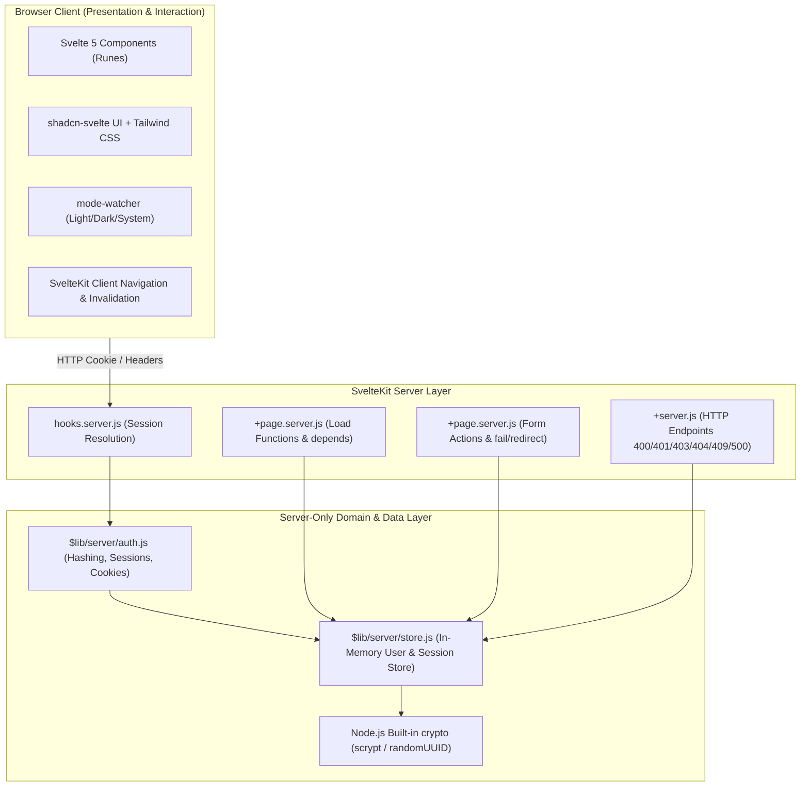

# Orbit User Portal — Comprehensive Implementation Plan

## Goal Description

Build **Orbit User Portal**, a modern, full-stack-style SaaS user management web application built with **Svelte 5 (Runes)** and **SvelteKit**, written exclusively in **JavaScript** (no TypeScript), styled with **Tailwind CSS** and **shadcn-svelte**, and powered by a centralized server-side in-memory mock store with session-based authentication and role-based access control (RBAC).

The application simulates a production-grade SaaS portal architecture with realistic security boundaries, server-side data loading and mutations, data freshness invalidation, an administrative user management console, responsive navigation, dark/light theming, and an interactive request-lifecycle debugging laboratory.

---

## User Review Required

> [!IMPORTANT]
> **Pedagogical & Explanatory Protocol**: Per your request, this project is built as an interactive learning laboratory. For every implementation step, I will provide an in-depth, crystal-clear explanation covering:
> 1. **The Goal**: What the component/module does.
> 2. **Architectural Context**: Where it executes (client vs server) and why.
> 3. **Code Anatomy**: Svelte 5 runes (`$state`, `$derived`, `$props`), SvelteKit conventions (`hooks`, `load`, `actions`), and crypto mechanics.
> 4. **Security & Engineering Implications**: The risks of improper implementation.
> 5. **Testing & Inspection**: How you can observe and verify the behavior yourself.
> Learning progress will be tracked in [learning_plan.md](file:///c:/Users/hp/Desktop/p/Useful%20learning%20projects/1.Orbit%20User%20Portal/learning_plan.md) and [learning_progress.md](file:///c:/Users/hp/Desktop/p/Useful%20learning%20projects/1.Orbit%20User%20Portal/learning_progress.md).

> [!IMPORTANT]
> **JavaScript-Only Constraint**: In strict adherence to Section 2.2 of [documentation.md](file:///c:/Users/hp/Desktop/p/Useful%20learning%20projects/1.Orbit%20User%20Portal/documentation.md), no TypeScript files (`.ts`), type declarations, or `lang="ts"` in Svelte components will be used. All modules are `.js` and Svelte components `.svelte`. The `components.json` for shadcn-svelte will be configured with `"typescript": false`.

> [!IMPORTANT]
> **Single Source of Truth**: All user records and sessions reside in server-only modules (`src/lib/server/store.js` and `src/lib/server/auth.js`). Seeded accounts (`member@example.com` and `admin@example.com`) and runtime-created accounts will live in the exact same store with identical password hashing standards using Node.js built-in `crypto`.

> [!NOTE]
> **Development Lifecycle & Persistence**: Data persists in server memory during dev server runtime and resets upon server restart. No external database or OAuth provider will be introduced, adhering strictly to Section 1.3 and Section 13.

---

## Architecture Overview



---

## Phased Implementation Plan

### Phase 1: Project Initialization & Tooling Setup
- **1.1 Initialize SvelteKit project** with JavaScript template (`npx -y create-vite@latest ./ --template svelte` or SvelteKit initialization non-interactive).
- **1.2 Install core dependencies**:
  - `svelte` (v5 with Runes support)
  - `@sveltejs/kit`
  - `tailwindcss`, `postcss`, `autoprefixer`
  - `clsx`, `tailwind-merge`
  - `mode-watcher`
  - `@lucide/svelte`
  - shadcn-svelte dependencies (`bits-ui`, etc.)
- **1.3 Configure Tailwind CSS & PostCSS**:
  - Setup `tailwind.config.js` with semantic color tokens (`background`, `foreground`, `card`, `primary`, `muted`, `destructive`, `border`, `ring`, etc.) matching shadcn-svelte standards.
  - Setup `src/app.css` with CSS variables for `@layer base` for both light and dark themes.
- **1.4 Configure `components.json` for shadcn-svelte**:
  - Set `"typescript": false`.
  - Set aliases: `$lib/components`, `$lib/utils`, `$lib/components/ui`.
- **1.5 Install shadcn-svelte components via CLI**:
  - Button, Card, Input, Label, Badge, Table, Dialog, Alert Dialog, Dropdown Menu, Select, Avatar, Sheet, Skeleton, Alert, Sonner, Separator.
- **1.6 Configure `jsconfig.json`**:
  - Define path aliases (`$lib/*` -> `./src/lib/*`).
- **1.7 Smoke test dev server**:
  - Ensure clean boot with `npm run dev` and zero errors.

---

### Phase 2: Server-Only Data Store & Security Primitives
- **2.1 File: `src/lib/server/crypto.js`**:
  - Implement secure password hashing using Node.js built-in `crypto.scrypt` (or `crypto.pbkdf2Sync`) with salt generation (`crypto.randomBytes(16)`).
  - Implement constant-time comparison using `crypto.timingSafeEqual` to prevent timing attacks.
  - Implement random session identifier generation (`crypto.randomUUID()`).
- **2.2 File: `src/lib/server/store.js`**:
  - In-memory data store containing:
    - `users`: Map or Array of internal user records (`id`, `name`, `email`, `passwordHash`, `passwordSalt`, `role`, `status`, `bio`, `createdAt`).
    - `sessions`: Map of session records (`sessionId` -> `{ userId, createdAt, expiresAt }`).
  - Pre-seed accounts with hashed passwords:
    - `member@example.com` / `member123` (Role: `user`, Status: `active`)
    - `admin@example.com` / `admin123` (Role: `admin`, Status: `active`)
  - Internal CRUD and domain methods:
    - `getUsers()`
    - `getUserById(id)`
    - `getUserByEmail(email)`
    - `createUser({ name, email, password, role, bio })`
    - `updateUserProfile(id, { name, bio })`
    - `updateUserRole(id, newRole)`
    - `setUserStatus(id, newStatus)`
    - `verifyCredentials(email, password)`
    - `getActiveAdminCount()`
  - Enforce critical invariants:
    - Final active administrator guard: demotion (`updateUserRole`) or deactivation (`setUserStatus('inactive')`) must fail with error if `getActiveAdminCount() <= 1`.
    - Email uniqueness check with normalized lowercase & trimmed email.
  - Safe data transformer:
    - `toSafeUser(user)`: strips `passwordHash`, `passwordSalt`.
    - `toPublicDirectoryUser(user)`: returns only id, name, role, status, bio, createdAt.

---

### Phase 3: Authentication, Session Management & Server Hooks
- **3.1 File: `src/lib/server/auth.js`**:
  - `createSession(userId, cookies)`: generates session ID, records in store, sets `session_id` cookie (`HttpOnly`, `Path=/`, `SameSite=lax`, `maxAge=60*60*24*7`).
  - `resolveSession(cookies)`: reads cookie, finds session, looks up user, verifies user exists and `status === 'active'`. If inactive or missing, invalidates session and returns `null`.
  - `destroySession(cookies)`: deletes session record, clears cookie (`delete('session_id', { path: '/' })`).
  - Authorization guards:
    - `requireUser(locals)`: throws `redirect(303, '/login')` if not authenticated.
    - `requireAdmin(locals)`: checks `locals.user?.role === 'admin'`; throws `error(403, 'Forbidden: Administrator access required')` or redirects.
- **3.2 File: `src/hooks.server.js`**:
  - Request lifecycle hook:
    - Invokes `resolveSession(event.cookies)`.
    - Populates `event.locals.user = safeUser` or `null`.
    - Global route guarding:
      - Protect `/dashboard`, `/profile`, `/users` from anonymous visitors -> redirect to `/login`.
      - Protect `/admin` and `/admin/*` from non-admins -> `error(403, 'Forbidden')` or redirect.
      - Protect `/login` and `/register` from already authenticated users -> redirect to `/dashboard`.
- **3.3 File: `src/routes/+layout.server.js`**:
  - Exposes `{ user: locals.user }` to all client routes.

---

### Phase 4: Shared Application Shell, Layout & Theme System
- **4.1 Root layout (`src/routes/+layout.svelte`)**:
  - Setup `mode-watcher` (`<ModeWatcher />`) for theme initialization with zero flash.
  - Setup `Sonner` (`<Toaster richColors position="top-right" />`).
  - Provide global styling and responsive wrapper.
- **4.2 Component: `src/lib/components/theme-toggle.svelte`**:
  - Dropdown or toggle button switching between `Light`, `Dark`, and `System` modes with Lucide icons (`Sun`, `Moon`, `Laptop`).
- **4.3 Component: `src/lib/components/app-header.svelte`**:
  - Top navigation bar:
    - Breadcrumbs / page title.
    - Theme toggle.
    - Authenticated user avatar, display name, and role badge.
    - Dropdown menu with Profile link, Dashboard link, and Logout button.
    - Mobile menu trigger button.
- **4.4 Component: `src/lib/components/app-sidebar.svelte`**:
  - Desktop sidebar and mobile `Sheet`:
    - Orbit portal logo and branding.
    - Navigation items: Dashboard, Directory (`/users`), Profile (`/profile`), and for admins: Admin Overview (`/admin`), Manage Accounts (`/admin/users`).
    - Debug Lab link (`/debug-lab`).
    - Active link styling.
- **4.5 Component: `src/lib/components/confirm-action-dialog.svelte`**:
  - Accessible Alert Dialog for consequential administrative operations (e.g. account deactivation, role demotion).

---

### Phase 5: Public Routes & Authentication Pages
- **5.1 Route `/` (`src/routes/+page.svelte`)**:
  - Premium SaaS landing page.
  - Orbit User Portal hero banner, feature highlights (RBAC, security, audit directory, live debugging lab).
  - Conditional CTAs:
    - If anonymous: "Sign In", "Create an Account", quick seeded credentials helper badge.
    - If logged in: "Go to Dashboard" button.
- **5.2 Route `/login` (`src/routes/login/+page.svelte` & `+page.server.js`)**:
  - Server action `default`:
    - Extract `email`, `password`.
    - Validate presence and format.
    - Call `verifyCredentials(email, password)`.
    - Check if account is active. If inactive: return `fail(403, { message: 'This account has been deactivated. Contact an administrator.' })`.
    - If valid: create session, set cookie, redirect to `/dashboard`.
    - If invalid: return `fail(400, { message: 'Invalid email or password' })`.
  - Clean UI with email & password fields, loading state (`use:enhance`), inline alert for error feedback, link to `/register`, demo account quick-fill buttons for fast testing.
- **5.3 Route `/register` (`src/routes/register/+page.svelte` & `+page.server.js`)**:
  - Server action `default`:
    - Collect `name`, `email`, `password`, `confirmPassword`.
    - Strictly reject or ignore any client-supplied `role` (assign `role: 'user'` unconditionally).
    - Validate:
      - All fields required.
      - Valid email syntax.
      - Password >= 8 characters.
      - `password === confirmPassword`.
      - Email uniqueness (case-insensitive).
    - On validation error: return `fail(400, { errors, values: { name, email } })`.
    - On success: create user in store, create session & cookie, redirect to `/dashboard` with welcome notification.
- **5.4 Route `/logout` (`src/routes/logout/+server.js` and/or action)**:
  - Handles `POST` requests.
  - Calls `destroySession(cookies)`.
  - Redirects 303 to `/login`.

---

### Phase 6: User Portal Core Features
- **6.1 Route `/dashboard` (`src/routes/dashboard/+page.svelte` & `+page.server.js`)**:
  - Server load:
    - Loads current user data.
    - If user is `admin`, computes real store statistics:
      - Total accounts
      - Active accounts
      - Inactive accounts
      - Admin count
  - Regular User View:
    - Personalized greeting, account status badge, email, join date.
    - Quick action cards to Directory and Profile.
  - Admin View:
    - Metric overview cards with real metrics.
    - Direct access to User Management.
- **6.2 Route `/profile` (`src/routes/profile/+page.svelte` & `+page.server.js`)**:
  - Server load:
    - Loads safe user profile.
  - Server action `updateProfile`:
    - Validates `name` (required, 2-50 chars), `bio` (optional, max 500 chars).
    - Strictly prevents changing role, status, or email.
    - Updates store with `updateUserProfile(locals.user.id, { name, bio })`.
    - Invalidation trigger: `invalidate('app:users')`.
    - Returns `{ success: true, message: 'Profile updated successfully' }`.
- **6.3 Route `/users` (`src/routes/users/+page.svelte` & `+page.server.js`)**:
  - Server load:
    - `depends('app:users')`.
    - Returns all safe public user profiles.
  - Interactive Svelte 5 rune UI:
    - Search input filtering by name and role in real time.
    - Role badges (`Admin` in purple/primary, `User` in secondary).
    - Status badges (`Active` in green, `Inactive` in red/muted).
    - Cards/Table with link to `/users/[id]`.
    - Empty state when search yields no matches.
- **6.4 Route `/users/[id]` (`src/routes/users/[id]/+page.svelte` & `+page.server.js`)**:
  - Server load:
    - `depends('app:users')`.
    - Reads `params.id`.
    - Fetches user from store: if not found, calls `error(404, 'User not found')`.
    - Returns safe user details.
  - UI displays user profile card, bio, status, role, join date, back to directory button.

---

### Phase 7: Administrative Console & User Management
- **7.1 Route `/admin` (`src/routes/admin/+page.svelte` & `+page.server.js`)**:
  - Enforces `requireAdmin(locals)`.
  - `depends('app:users')`.
  - Displays high-level administrative metrics and quick links to account controls.
- **7.2 Route `/admin/users` (`src/routes/admin/users/+page.svelte` & `+page.server.js`)**:
  - Enforces `requireAdmin(locals)`.
  - `depends('app:users')`.
  - Loads full administrative list of users (including emails and statuses).
  - **Features**:
    - Account Creation Dialog (Collects Name, Email, Password, Role).
    - Filter by Role (`all`, `admin`, `user`) and Status (`all`, `active`, `inactive`).
    - Search by Name or Email.
    - Change Role action (Demote/Promote).
    - Toggle Status action (Activate / Deactivate) with confirmation alert dialog.
    - Safety invariant check:
      - If attempting to deactivate or demote the last active admin, the server rejects with `fail(400, { message: 'Cannot deactivate or demote the last active administrator.' })`.
  - Server actions in `+page.server.js`:
    - `createUser`: Validates input, hashes password, creates user with selected role.
    - `updateRole`: Calls `updateUserRole(id, role)` enforcing invariant.
    - `toggleStatus`: Calls `setUserStatus(id, newStatus)` enforcing invariant.
- **7.3 API Route: `/api/users/[id]/status` (`src/routes/api/users/[id]/status/+server.js`)**:
  - `POST` / `PATCH` endpoint for status changes.
  - Enforces `401 Unauthorized` if not logged in.
  - Enforces `403 Forbidden` if not admin.
  - Enforces `404 Not Found` if user ID invalid.
  - Enforces `400 Bad Request` if target is last active admin or invalid status.
  - Returns `200 OK` with JSON `{ success: true, user }`.

---

### Phase 8: Controlled Debugging Laboratory (`/debug-lab`)
- **8.1 Scenario A Endpoint: `/api/debug/echo` (`src/routes/api/debug/echo/+server.js`)**:
  - `POST` endpoint expecting `{ "email": string }`.
  - If request body contains `username` instead of `email`, returns `400 Bad Request` with contract mismatch error explanation.
- **8.2 Scenario B Endpoint: `/api/debug/users/[id]` (`src/routes/api/debug/users/[id]/+server.js`)**:
  - `GET` endpoint. Looks up user by ID.
  - If user not found, returns `404 Not Found` with `{ error: 'User resource does not exist', requestedId: params.id }`.
- **8.3 Scenario C Endpoint: `/api/debug/trigger-error` (`src/routes/api/debug/trigger-error/+server.js`)**:
  - `GET` endpoint.
  - Only active in development (`import.meta.env.DEV`). In production returns `403 Forbidden`.
  - Deliberately throws an unhandled server exception to trigger `500 Internal Server Error`.
- **8.4 Scenario D Endpoint: `/api/debug/session` (`src/routes/api/debug/session/+server.js`)**:
  - `GET` endpoint.
  - Reads `event.cookies.get('session_id')` and inspects `event.locals.user`.
  - Returns JSON explaining whether the session cookie was present and whether session resolution succeeded.
- **8.5 Debug Lab UI (`src/routes/debug-lab/+page.svelte`)**:
  - Interactive laboratory workbench with 4 scenario cards.
  - Each scenario includes:
    - Description & expected failure mechanism.
    - Action trigger button ("Run Scenario").
    - Option toggles (e.g. for Scenario D: standard fetch vs `credentials: 'omit'`, for Scenario A: send invalid payload vs fixed payload).
    - Real-time inspector display:
      - Request URL & Method.
      - Request Payload & Headers.
      - HTTP Status (with color coding: 200 green, 400 yellow, 401/403 amber, 404 purple, 500 red).
      - Response Body (formatted JSON).
      - Diagnostic Lifecycle Analysis explaining which layer intercepted or failed the request.

---

### Phase 9: Verification, Accessibility & Polish
- **9.1 Comprehensive permission matrix testing** (Anonymous, User, Admin across all routes & actions).
- **9.2 Verification of invariants** (Last active admin protection, inactive account session rejection).
- **9.3 Data invalidation verification** (`invalidate('app:users')` triggers automatic UI updates).
- **9.4 Theme toggle & responsive mobile testing** (Light/Dark persistence, mobile Sheet drawer).
- **9.5 Browser subagent interactive testing** (Navigating through landing, login, dashboard, admin, debug lab).

---

## File Structure Plan

```text
src/
├── app.css
├── app.html
├── hooks.server.js
├── lib/
│   ├── server/
│   │   ├── crypto.js
│   │   ├── store.js
│   │   └── auth.js
│   ├── components/
│   │   ├── ui/
│   │   │   ├── button/
│   │   │   ├── card/
│   │   │   ├── input/
│   │   │   ├── label/
│   │   │   ├── badge/
│   │   │   ├── table/
│   │   │   ├── dialog/
│   │   │   ├── alert-dialog/
│   │   │   ├── dropdown-menu/
│   │   │   ├── select/
│   │   │   ├── avatar/
│   │   │   ├── sheet/
│   │   │   ├── skeleton/
│   │   │   ├── alert/
│   │   │   ├── sonner/
│   │   │   └── separator/
│   │   ├── app-sidebar.svelte
│   │   ├── app-header.svelte
│   │   ├── theme-toggle.svelte
│   │   └── confirm-action-dialog.svelte
│   └── utils.js
└── routes/
    ├── +layout.server.js
    ├── +layout.svelte
    ├── +page.svelte
    ├── login/
    │   ├── +page.svelte
    │   └── +page.server.js
    ├── register/
    │   ├── +page.svelte
    │   └── +page.server.js
    ├── logout/
    │   └── +server.js
    ├── dashboard/
    │   ├── +page.svelte
    │   └── +page.server.js
    ├── profile/
    │   ├── +page.svelte
    │   └── +page.server.js
    ├── users/
    │   ├── +page.svelte
    │   ├── +page.server.js
    │   └── [id]/
    │       ├── +page.svelte
    │       └── +page.server.js
    ├── admin/
    │   ├── +page.svelte
    │   ├── +page.server.js
    │   └── users/
    │       ├── +page.svelte
    │       └── +page.server.js
    ├── api/
    │   ├── users/
    │   │   └── [id]/
    │   │       └── status/
    │   │           └── +server.js
    │   └── debug/
    │       ├── echo/
    │       │   └── +server.js
    │       ├── session/
    │       │   └── +server.js
    │       ├── users/
    │       │   └── [id]/
    │       │       └── +server.js
    │       └── trigger-error/
    │           └── +server.js
    └── debug-lab/
        └── +page.svelte
```

---

## Verification Plan

### Automated Checks
- `npm run check` (Svelte verification for JavaScript/syntax errors)
- `npm run build` (Production build verification)

### Manual & Interactive Verification
1. **Authentication Flows**:
   - Log in as `member@example.com` / `member123` -> Verify redirect to `/dashboard`.
   - Register a new user -> Verify automatic user role and dashboard redirect.
   - Log out -> Verify session cookie cleared and redirected to `/login`.
2. **Access Control**:
   - Access `/admin` as regular user -> Verify 403 Forbidden.
   - Access `/dashboard` when logged out -> Verify 303 redirect to `/login`.
3. **Data Management & Invariants**:
   - Admin creates a new user -> Verify user appears in `/users` directory without manual reload.
   - Admin deactivates regular user -> Verify regular user's active session is rejected immediately on subsequent navigation.
   - Admin attempts to deactivate or demote `admin@example.com` (last admin) -> Verify operation blocked with error message.
4. **Debugging Lab**:
   - Scenario A: Trigger echo mismatch -> Inspect 400 Bad Request.
   - Scenario B: Request nonexistent user -> Inspect 404 Not Found.
   - Scenario C: Trigger deliberate server error -> Inspect 500 error in dev.
   - Scenario D: Send session check with credentials omitted -> Inspect cookie absence.
5. **Aesthetics & Theming**:
   - Switch between Light, Dark, System -> Verify UI themes smoothly with zero broken styles.
